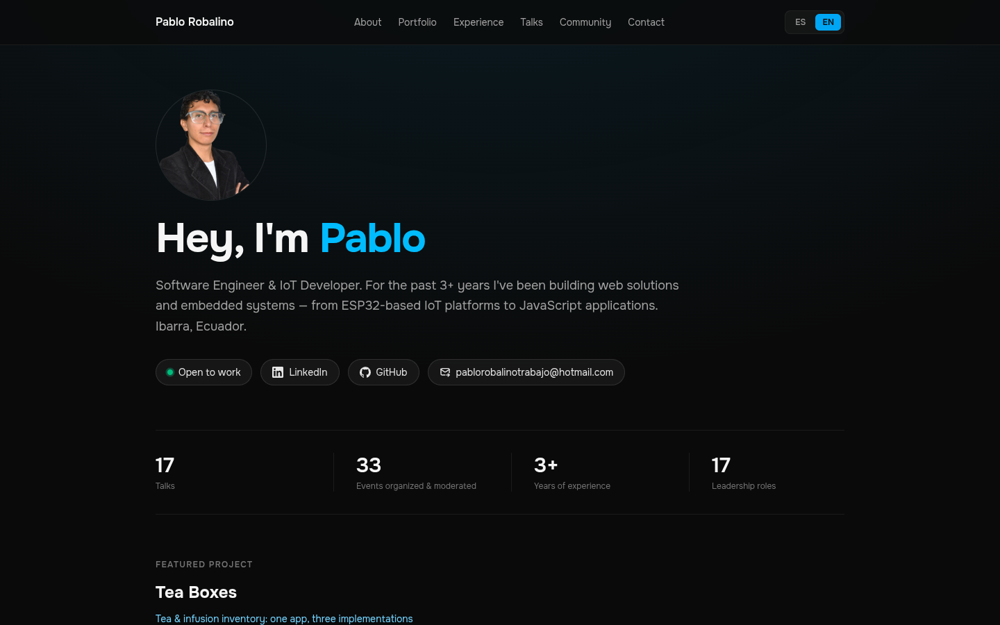

# website-PabloRobalino

Bilingual (ES/EN) personal website built with Astro and Tailwind CSS 4, featuring a custom dual-render internationalization system and zero UI framework dependencies.

[](https://pablorobalino.pages.dev)

## Technical Stack

- **Framework:** Astro 7.3.8 (Static output)
- **Styling:** Tailwind CSS 4.3.3 (CSS-first architecture)
- **Language:** TypeScript 6.0.3
- **Fonts:** @fontsource-variable/onest
- **Runtime:** Node.js >= 22.12.0

## Technical Features

- **Static Build:** Full static site generation without SSR or client-side UI frameworks.
- **Custom i18n Architecture:** Single route per page system (no localized subdirectories or URL prefixes).
- **Runtime Language Toggle:** Client-side detection via `navigator.language` with `localStorage` persistence and instant language switching without page reloads.
- **Zero-Flash Internationalization:** Blocking inline script in `<head>` ensures the correct language is rendered before the first paint.
- **Type-Safe Data Structure:** Centralized UI dictionary and structured content data using TypeScript interfaces for bilingual field enforcement.
- **Accessibility:** Semantic HTML with `aria-current`, `aria-pressed`, and dynamic `<html>` lang attribute updates.

## How the i18n works

The custom `<Trans>` component renders both languages into the HTML using `data-i18n-lang` attributes. CSS rules toggle visibility of elements based on the active `lang` attribute of the `<html>` element. An early-execution script in the Document Head detects or retrieves the user's language preference to prevent content flashing. UI strings are managed in `src/i18n/ui.ts` while structured content lives in `src/data/` utilizing the `TranslatableString` type.

## Project Structure

```text
src/
├── components/    # Reusable UI components (Astro)
│   └── icons/     # SVG icon components
├── data/          # Structured content with inline es/en fields
├── i18n/          # Translation dictionary (ui.ts) and language helpers
├── layouts/       # Base page layouts and View Transition logic
├── pages/         # Static routes and page components (one per section)
│   └── portfolio/ # Portfolio dynamic routes
└── styles/        # Global CSS and Tailwind CSS v4 directives
```

## Data File Format

All structured content lives in `src/data/` and uses the `TranslatableString` type for bilingual fields:
```ts
type TranslatableString = { es: string; en: string };
```

### Transversal Rules

| Field Type | Examples | Behavior |
|------------|----------|----------|
| **Proper Nouns** | `org`, `event`, `institution`, `company`, `provider`, `tech`, `location` | **NEVER** translated. Plain `string`. |
| **Narrative / UI** | `degree`, `role`, `bullets`, `description`, `tagline`, `title` (courses), `result` (awards), `interests` | **ALWAYS** `TranslatableString`. |
| **Dates** | `period.start`, `date`, `period.end` | ISO format: `YYYY-MM` or `YYYY`. |
| **Enums** | `role`, `type`, `category`, `mode`, `language` | Strict literal values defined in interfaces. TypeScript will fail on mismatch. |
| **Array Order** | `roles`, `events`, `experiences`, `projects`, `talks` | Chronological **descending** order (newest first). |

### `about.ts`
- **`education`**: Academic degrees. `degree` is translatable; `institution` and `location` are proper nouns.
- **`trainingGroups`**: Complementary courses. `provider` is a proper noun; `courses` are translatable strings.
- **`interests`**: Array of `TranslatableString`.

### `community.ts`
- **`roles`**: Leadership positions. `role` is translatable; `org` is a proper noun.
- **`events`**: Community involvement. `event` is a proper noun; `role` is an enum (`lead`, `moderator`, `staff`, `attendee`); optional `detail` is translatable.
- **`volunteering`**: Volunteer campaigns. `activity` and `org` are proper nouns; optional `description` is translatable.
- **`awards`**: Competitions and recognitions. `type` is an enum (`competition`, `award`, `cultural`); `result` and `what` are translatable; `org` is optional proper noun.
- **`memberships`**: Organization memberships. `org` is a proper noun; `end` is optional (absent = current).

### `experience.ts`
- **`experiences`**: Professional history. `position` and `bullets` are translatable; `company` and `location` are proper nouns; `tech` is a plain string array.

### `projects.ts`
- **`projects`**: Portfolio items. `title`, `tagline`, and `description` are translatable; `slug` is a unique kebab-case identifier; `category` is an enum (`iot`, `web`, `software`); `tech` is a plain string array.

### `talks.ts`
- **`talks`**: Conference talks. `title` and `event` are proper nouns; `language` is an enum (`es`, `en`).
- **`courses`**: Taught courses. `title` is translatable; `context` is a proper noun; `mode` is an enum (`presencial`, `virtual`, `hibrido`).

## Getting Started

1. Clone the repository:
   ```bash
   git clone https://github.com/PabloJoseRobalinoLucero
   ```
2. Navigate to the project directory:
   ```bash
   cd website-PabloRobalino
   ```
3. Install dependencies:
   ```bash
   npm install
   ```
4. Start the development server:
   ```bash
   npm run dev
   ```
   The site will be available at `http://localhost:4321`.

## Live Demo

<https://pablorobalino.pages.dev>

**⚠️ IMPORTANTE: Google Search Console Verification**  
Para que Google indexe tu sitio correctamente, debes mantener la meta tag de verificación activa.  
El archivo `src/layouts/Layout.astro` ya incluye:

```html
<meta name="google-site-verification" content="MjhJOdX3LyE8Jkbx6PPvpCGo0YK4Bqs3SMCkcodYu-o" />
```

**PASOS CRÍTICOS - NUNCA ELIMINES ESTO:**

1. **NUNCA elimines** la meta tag `<meta name="google-site-verification" content="MjhJOdX3LyE8Jkbx6PPvpCGo0YK4Bqs3SMCkcodYu-o" />` de `src/layouts/Layout.astro`
2. Si necesitas cambiar el contenido del `content="..."`, debes:
   - Generar una nueva clave en [Google Search Console](https://search.google.com/search-console)
   - Reemplazar el valor en `src/layouts/Layout.astro` con la nueva clave
3. Después de cambiar la clave, espera 24-48 horas para que Google propague el cambio
4. El sitio se recomienda inicialmente para la propiedad `pablorobalino.pages.dev`

Sin esta meta tag, Google no podrá verificar la propiedad y podría no indexar tu sitio correctamente.

## Available Commands

| Command | Action |
| :--- | :--- |
| `npm run dev` | Starts local dev server at localhost:4321 |
| `npm run build` | Builds the static site for production to `./dist` |
| `npm run preview` | Previews the build locally before deploying |
| `npx astro check` | Runs TypeSript and Astro diagnostic checks |

## License

This project is licensed under the **MIT License with Visible Attribution Requirement**. It permits free use and modification provided that the original copyright notice and the visible attribution ("Designed by [Author Name]") are maintained in the user interface. Refer to the `LICENSE` file for the full legal text and specific attribution requirements.
